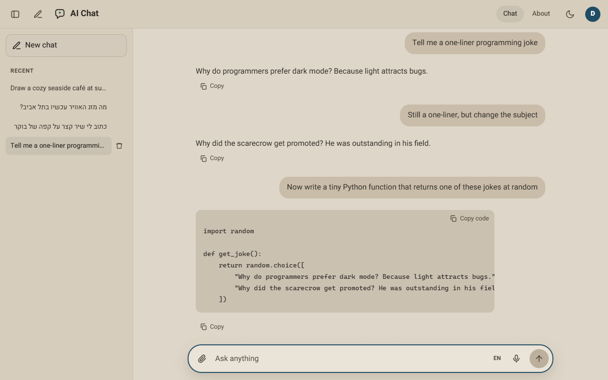
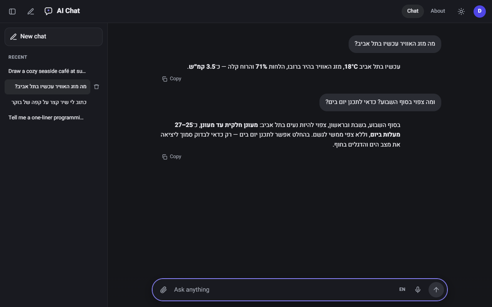
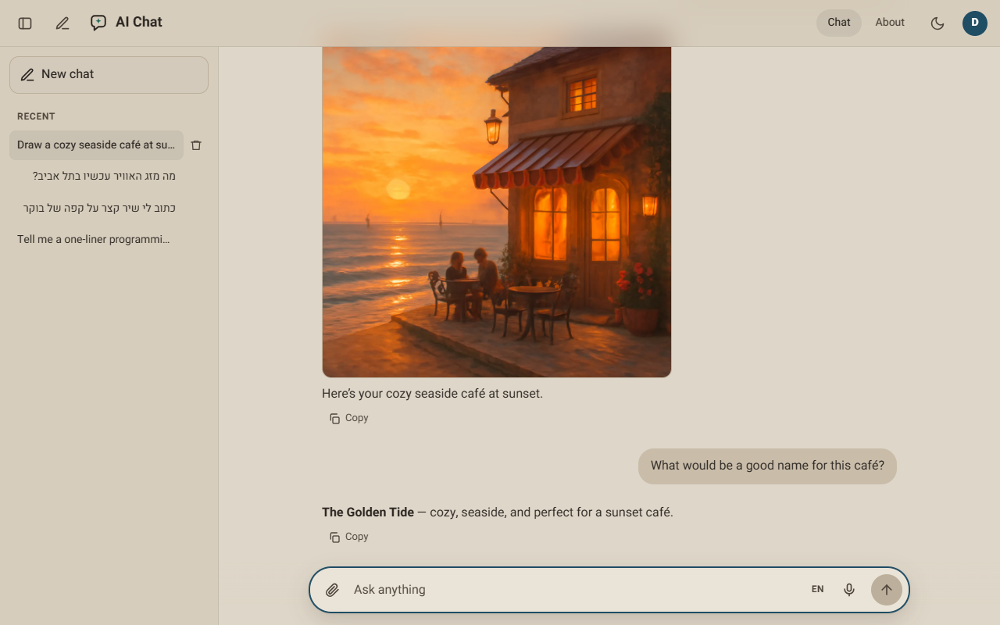
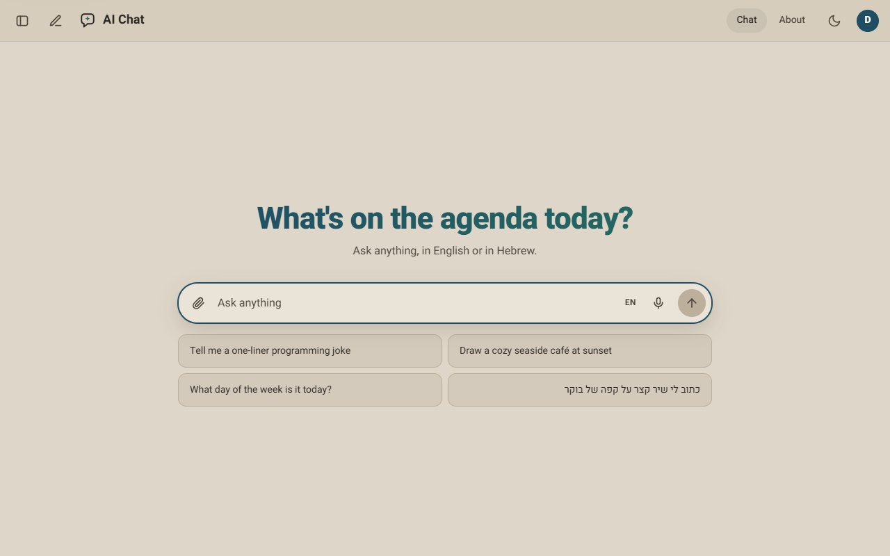
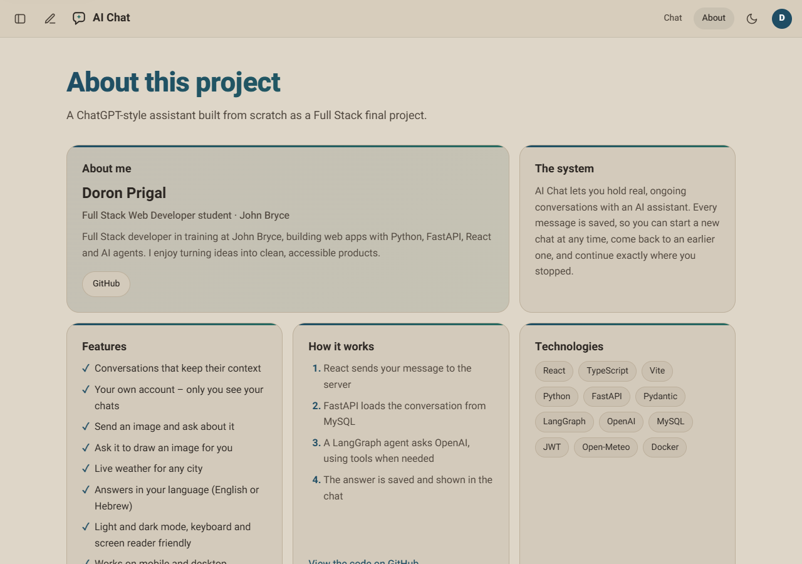
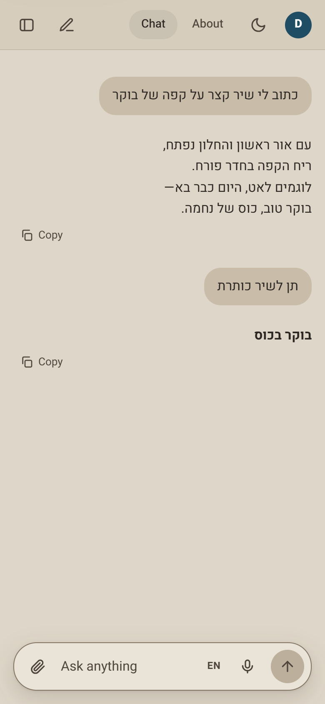
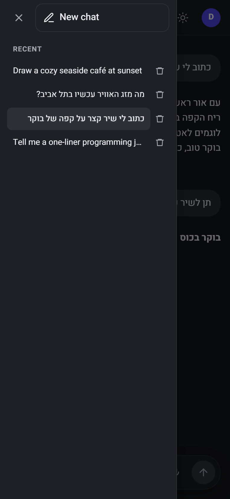

# AI Chat Assistant

A ChatGPT-style web app: a React SPA talks to a FastAPI REST API, which runs a LangGraph agent on top of OpenAI and stores every conversation in MySQL.

Final project – Full Stack Web Developer course, John Bryce.

**GitHub:** https://github.com/DoronPrigal/ai-chat-assistant

**Demo user:** `demo` / `demo1234` – available after importing the sample data (see [Sample data](#sample-data-optional)). It has 4 conversations: English with code, Hebrew, weather, and a generated image. You can also register a new account.

## Screenshots

| Chat (light) | Hebrew + weather (dark) |
|---|---|
|  |  |
| **Image generation** | **New chat** |
|  |  |

| About | Mobile | Mobile drawer |
|---|---|---|
|  |  |  |

## Tech stack

| Layer | Technology |
|---|---|
| Frontend | React + Vite + TypeScript, pure CSS |
| Backend | Python 3.14, FastAPI, Pydantic |
| AI | LangGraph agent, `langchain-openai` (OpenAI is called only from the server) |
| Database | MySQL 8 (Docker), phpMyAdmin |

## Project structure

```
DoronPrigal/
├── Backend/            FastAPI app, LangGraph agent, requirements.txt, Postman collection (+ postman/sample.png)
├── Frontend/           React app
├── Database/           MySQL export – db_export.sql (structure + sample data)
└── docker-compose.yml  MySQL + phpMyAdmin (+ an optional Backend service, see below)
```

The test scripts used during development (Playwright, API tests) are in the [`tests/`](https://github.com/DoronPrigal/ai-chat-assistant/tree/main/tests) folder on GitHub. They are not part of the submitted ZIP.

## Getting started (Windows / PowerShell)

Requirements: Docker Desktop, Python 3.14, Node.js 20.19 or newer.

### 1. Database

```powershell
docker compose up -d
```

On the very first run MySQL needs about 20–30 seconds to initialize. Wait for it before starting the Backend.

- MySQL: `localhost:3306` (database `chat_db`)
- phpMyAdmin: http://localhost:8080 (user `root`, password from `docker-compose.yml`)

If you ran an older version of the project before, reset the database so the tables are created with the current structure: `docker compose down -v` and then `docker compose up -d` (this deletes all local data).

**Without Docker:** any local MySQL 8 works too. Create a database named `chat_db` (utf8mb4) and set `DB_HOST`, `DB_PORT`, `DB_USER` and `DB_PASSWORD` in `Backend/.env` (step 2).

#### Sample data (optional)

`Database/db_export.sql` contains the tables and the demo user (`demo` / `demo1234`) with 4 conversations. Its image is in `Backend/uploads`. Import it once MySQL is running – **this replaces the existing tables**:

- **phpMyAdmin:** http://localhost:8080 → Import → choose `Database/db_export.sql` → Import.
- **Or from PowerShell** (in the project folder):
  ```powershell
  docker cp Database/db_export.sql chat_mysql:/tmp/db_export.sql
  docker exec chat_mysql sh -c "mysql -uroot -pchat_root_pass < /tmp/db_export.sql"
  ```
- **Local MySQL without Docker:** `mysql -u root -p < Database/db_export.sql` (in cmd, or MySQL Workbench → Run SQL Script).

Without the import, the Backend creates empty tables on its first run.

### 2. Backend

```powershell
cd Backend
py -3.14 -m venv env
.\env\Scripts\activate
pip install -r requirements.txt
copy .env.example .env
python -c "import secrets; print(secrets.token_hex(32))"
uvicorn main:app --reload
```

Before starting the server, edit `Backend/.env`:
- `OPENAI_API_KEY` – your OpenAI API key.
- `JWT_SECRET` – paste the random string printed by the `secrets` command above. The server refuses to start without a secret of at least 32 characters.

If PowerShell blocks `activate`, run once: `Set-ExecutionPolicy -Scope CurrentUser RemoteSigned`.

The API runs on http://localhost:8000. Tables are created automatically on first run.
Interactive docs: http://localhost:8000/docs

#### Alternative: run the Backend in Docker

Use this instead of the steps above if Python cannot run locally (for example, when Windows Smart App Control blocks a library DLL). You still need `Backend/.env` (`copy .env.example .env` and fill it in as above).

```powershell
docker compose --profile api up -d --build
```

- This starts MySQL, phpMyAdmin and the API (`chat_api`) on http://localhost:8000. Without `--profile api`, `docker compose up -d` starts only the database, as in step 1.
- The `Backend` folder is mounted into the container, so code changes reload automatically, and images stay in `Backend/uploads`.
- Inside Docker the API connects to the `mysql` service, so `docker-compose.yml` overrides `DB_HOST` – no change to `.env` is needed.
- Logs: `docker logs -f chat_api`. After changing `requirements.txt`, run the command again (`--build`).

### 3. Frontend

```powershell
cd Frontend
npm install
npm run dev
```

Open http://localhost:5173 (the Backend must be running on port 8000).

## API endpoints

All `/api/conversations` and `/api/uploads` endpoints require `Authorization: Bearer <token>`. Conversations are scoped to the logged-in user (another user's conversation returns 404).

| Method | Path | Description |
|---|---|---|
| GET | `/api/health` | Server and database check |
| POST | `/api/auth/register` | Create an account, returns a JWT |
| POST | `/api/auth/login` | Log in, returns a JWT |
| GET | `/api/auth/me` | The logged-in user |
| GET | `/api/conversations` | List conversations, newest first |
| POST | `/api/conversations` | Start a conversation with its first message (created only after the agent answers) |
| POST | `/api/conversations/stream` | Same, but the answer is streamed word by word (see below) |
| GET | `/api/conversations/{id}` | A conversation with all its messages |
| POST | `/api/conversations/{id}/messages` | Send a message (text and/or `image_path`) and get the agent's reply |
| POST | `/api/conversations/{id}/messages/stream` | Same, but the answer is streamed word by word |
| DELETE | `/api/conversations/{id}` | Delete a conversation, its messages and its image files |
| POST | `/api/uploads` | Upload an image (PNG, JPEG, WebP or GIF, up to 5 MB), returns its `image_path` |
| GET | `/uploads/{file}` | The image file itself (random, unguessable file names) |

### Postman

`Backend/AI_Chat_Assistant.postman_collection.json` covers every endpoint, including streaming, image upload and error cases (401 / 404 / 422). Import it into Postman and run the requests in order (or **Run collection**):
- **Register** / **Login** save the JWT in the `token` variable, and all other requests send it automatically (Bearer).
- **Create conversation** saves `conversationId`, and **Upload image** saves `imagePath`.
- **Upload image needs a file.** A sample image is included: `Backend/postman/sample.png`. Choose it in one of two ways:
  - In the request **Upload image** → **Body** tab → the `file` row → **Select files** → choose `Backend/postman/sample.png`. Save the request (Ctrl+S) so Run collection uses it too.
  - Or copy `sample.png` to Postman's working directory, `C:\Users\<your user name>\Postman\files` (Settings → General → Working directory). The collection already points to `sample.png`, so it is found automatically.
- **Errors and security** registers a second user and checks that it gets 404 for the first user's conversation.
- Each request has tests that check the response.
- **Generate an image** costs about half a cent, so it is skipped unless you set the collection variable `runImageGeneration` to `true`.

## The AI agent

A LangGraph ReAct loop (`agent` node + `tools` node) in `Backend/agent/`:
- **Chat model:** `gpt-6-luna` (OpenAI), the last 20 messages of the conversation are sent as context.
- **Vision:** an attached image is sent to the model together with the text, so you can ask about it.
- **Tools:**
  - `get_current_datetime` – the current date and time.
  - `get_weather` – current weather and a 7-day forecast for any city, from [Open-Meteo](https://open-meteo.com/) (free, no API key). The agent translates the city name to English (e.g. "מודיעין" → "Modiin"), finds its location, and then gets the forecast.
  - `generate_image` – creates an image with `gpt-image-1-mini` (1024×1024, low quality, about half a cent per image) when the user asks to draw something.

Images are stored as files in `Backend/uploads/` (not in Git); the database stores only their path.

### Streaming

The chat uses the `/stream` endpoints: the graph runs with `stream_mode="messages"` and FastAPI's `StreamingResponse` sends one JSON line per event (NDJSON):

| Event | Meaning |
|---|---|
| `{"type": "tool", "name": "get_weather"}` | The agent is calling a tool – the UI shows "Checking the weather…" |
| `{"type": "token", "text": "..."}` | The next piece of the answer |
| `{"type": "done", "user_message": {...}, "assistant_message": {...}}` | The full answer was saved (a new chat also gets `conversation`) |
| `{"type": "error", "message": "..."}` | The agent failed – nothing was saved, the UI offers "Try again" |

Messages are saved only after the full answer, exactly like the regular endpoints. If the agent fails or the user leaves mid-answer, nothing is saved and any image it created is deleted.

## Other features

- **Voice input:** a microphone button uses the browser's Web Speech API (no library, no cost), in Hebrew or English (the HE/EN button). The text goes into the input box for editing – it is not sent automatically. The button appears only in browsers that support it (Chrome, Edge, Safari).
- **Error Boundary:** if a component crashes, a friendly "Something went wrong" screen with a Reload button appears instead of a blank page.

### Known limitation: image links are public

Image files are served at `/uploads/<random-name>` **without a login check**, because a browser `` tag cannot send the JWT header. The file names are random 128-bit values (UUID), so they cannot be guessed or listed – but anyone who gets the exact link of an image can open it. Messages and conversations themselves are always protected by login.

## Database design

- `users` – registered users. Passwords are stored only as bcrypt hashes.
- `conversations` – one row per chat (`id` is the unique conversation id), owned by a user (`user_id`).
- `messages` – every message, with `role` (`user` / `assistant`), `conversation_id`, and an optional `image_path` (an image the user attached or the agent created).

Deleting a user deletes their conversations, and deleting a conversation deletes its messages (`ON DELETE CASCADE`).
